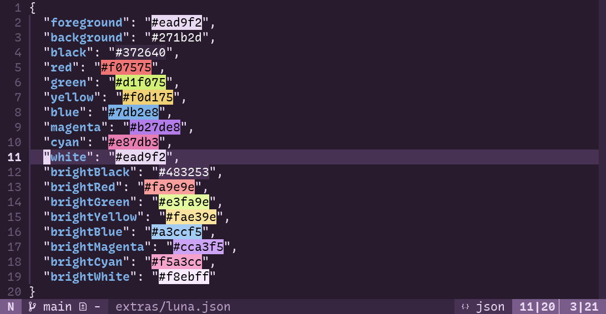

# luna.nvim

a neovim colorscheme descended from [fairyfloss](https://github.com/sailorhg/fairyfloss) and sister to [moonqueen.nvim](https://codeberg.org/sailorfe/moonqueen.nvim). built with [lush](https://github.com/rktjmp/lush.nvim).

<div align="center">



</div>

<!-- toc -->

- [palette](#palette)
- [features](#features)
    * [plugins](#plugins)
    * [ports](#ports)
- [installation](#installation)
    * [lua](#lua)
    * [vimscript](#vimscript)
- [contributing](#contributing)
    * [adding plugins](#adding-plugins)
    * [adding ports](#adding-ports)
- [acknowledgments](#acknowledgments)

<!-- tocstop -->

## palette

|                                                                                                | key     | hex       |
| ---------------------------------------------------------------------------------------------- | ------- | --------- |
|     | base    | `#271B2D` |
|  | surface | `#372640` |
|  | overlay | `#483253` |
|     | text    | `#EAD9F2` |
|    | light   | `#F8EBFF` |
|     | mars    | `#F07575` |
|  | jupiter | `#D1F075` |
|    | venus   | `#F0D175` |
|  | mercury | `#7DB2E8` |
|   | saturn  | `#B27DE8` |
|     | moon    | `#E87DB3` |
|      | low     | `#291D2F` |
|      | med     | `#523C5D` |
|     | high    | `#7A5C8A` |

## features

### plugins

- [gitsigns.nvim](https://github.com/lewis6991/gitsigns.nvim)
- [indent-blankline.nvim](https://github.com/lukas-reineke/indent-blankline.nvim)
- [mini.nvim](https://github.com/nvim-mini/mini.nvim) diff, statusline, and tabline
- [render-markdown.nvim](https://github.com/MeanderingProgrammer)
- [trouble.nvim](https://github.com/folke/trouble.nvim)

### ports

- [alacritty](https://alacritty.org)
- [foot](https://codeberg.org/dnkl/foot)
- [gnu emacs](https://gnu.org/software/emacs)
- [mako](https://github.com/emersion/mako)
- [rio](https://rioterm.com)
- [termux](https://termux.dev)
- tty
- shell exports
- vim 8+ ([vim classic](https://vim-classic.org))
- [wezterm](https://wezterm.org)
- [zathura](https://github.com/pwmt/zathura)

## installation

### lua

with lazy:

```lua
return {
    "https://codeberg.org/sailorfe/luna.nvim",
--    init = function()
--        vim.cmd.colorscheme("luna")
--    end,
    opts = {
        transparent = false, -- default
        overrides = {
            keyword = { fg = #D1F075 },
            ["@boolean"] = { link = 'Special' ,}
        }
    }
}
```

alternately, you can skip `init = function()` and declare `vim.cmd.colorscheme('luna')` somewhere in your `init.lua` after plugin load.

it has just two options:

| name              | type              | default   | description                                                               |
| ----------------- | ----------------- | --------- | ------------------------------------------------------------------------- |
| `transparent`     | boolean           | false     | sets `Normal` and linked hl groups to `none` to show terminal background. |
| `overrides`       | table / boolean   | false     | override any hl groups you don't like or to add new ones.                 |


### vimscript

with vim-plug:

```vim
Plug 'https://codeberg.org/sailorfe/luna.nvim', { 'as': 'luna', 'rtp': 'extras/vim' }
```

or you can place `extras/colors/luna.vim` anywhere in your runtimepath:

```sh
curl -LO https://codeberg.org/sailorfe/luna.nvim/raw/branch/main/extras/vim/colors/luna.vim
```

then set colorscheme with `colorscheme luna` either in your `vimrc` or temporarily with a command:

```vim
" .vimrc
set background=dark
syntax on
colorscheme luna
```

## contributing

> [!NOTE]
> this repository is mirrored to [github](https://github.com/sailorfe/luna.nvim) from [codeberg](https://codeberg.org/sailorfe/luna.nvim). make pull requests to [codeberg](https://codeberg.org/sailorfe/luna.nvim/pulls).

### adding plugins

1. install [lush](https://github.com/rktjmp/lush.nvim) and [shipwright](https://github.com/rktjmp/shipwright.nvim). you should edit `scripts/init.lua` to point to your installations, or rely on a package manager. for example, **lazy**'s bootstrap places plugins in `~/.local/share/nvim/lazy`.
2. edit with `nvim lua/luna/lush.lua` and preview with `:Lushify`. append new highlight groups to the bottom of the `theme` table.
3. run `make build` at project root to generate `lua/luna/theme.lua`.
4. commit `lua/luna/{lush.lua,theme.lua}` with a message like `feat(plug): $PLUGIN`.

### adding ports

theme generation is helped by the `Makefile` at project root.

1. (optional) ensure `palette.json` is up to date: `make palette`.
2. create `templates/$APP.*` using keys from `palette.json`:
   - for hex codes prefixed with hashes (`#E87DB3`), use `[[key]]`. examples: `alacritty.toml`, `wezterm.toml`.
   - for hex codes *without* hashes (`E87DB3`), use `{{key}}`. examples: `foot.ini`, `tty.conf`.
   - for templates that take `rgba` or `hsl`, you can use `[[key-rgb]]` or `[[key-hsl]]`. example: `zathura`.
3. add the output path `$APP/luna.*` to the `outputs` dictionary in `scripts/generator.py`.
4. run the python script: `make generate`.
5. commit your input template, `scripts/generator.py`, and output extra with a message like `feat(extra): $APP`.

## acknowledgments

- [fairyfloss](https://github.com/sailorhg/fairyfloss) for inspiring this journey into colorschemes to begin with, and the low-contrast, magical girl vibes
- [evangelion.nvim](https://github.com/xero/evangelion.nvim) for weeb + `build.sh` inspiration + the whole lua project structure and opts logic
- [tokyonight.nvim](https://github.com/folke/tokyonight.nvim) for repository structure
